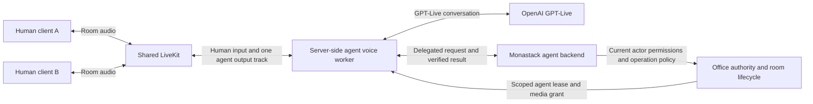

# Plan: Room-based GPT-Live voice agents

Latest product update: camera defaults on after authenticated media join; see [agent configuration](agent-configuration.md), which supersedes the original camera-off proposal below.

Status: implementation completed across milestones 1–5. See [the operational runbook and verification evidence](live-agent-voice.md). This document preserves the design rationale; the runbook describes the implemented scope and limits. Matrix chat remains separate.

## Product behavior

When an authenticated human enters an office room with a resident agent, that room's agent becomes available automatically to all authorized humans in the room. The server owns the agent lifecycle. Each client joins the same LiveKit media room in receive-only mode as needed; users do not establish independent conversations with duplicated agent responses.

- The agent may give a short greeting when the first human arrives. Joining users share the room conversation; do not repeat greetings on every heartbeat or interrupt an active conversation for every arrival.
- A user who enables their microphone can address the agent by voice. The microphone is never switched from off to on merely because the avatar moved. Camera capture is not required or automatically sent to OpenAI.
- Agent replies are published as a LiveKit audio track, so everyone currently authorized in the room hears the same response.
- Leaving the room, losing access or signing out ends that user's subscriptions and input. An empty room releases its Live session after an explicit grace period.
- A participant can locally mute an agent without muting the other humans. Administrative pause/stop controls affect the room agent, not unrelated rooms.
- Speaking and command execution are distinct states. Interrupting speech does not silently cancel a running task or imply that a write operation succeeded.

## Official OpenAI documentation findings

Reviewed on 2026-10-31:

1. [Getting started with GPT-Live](https://developers.openai.com/api/docs/guides/live): GPT-Live handles full-duplex voice separately from a delegated backend. Keep project credentials on the server.
2. [Partner integrations](https://developers.openai.com/api/docs/guides/live-partner-integrations): OpenAI lists a LiveKit OpenAI-plugin integration. The installed plugin version must explicitly support GPT-Live; Realtime compatibility alone is insufficient.
3. [WebSockets](https://developers.openai.com/api/docs/guides/voice-websockets?voice-api=live): a server-owned alternative uses `wss://api.openai.com/v1/live/sessions`, then `session.start` and `session.started`. The example uses `gpt-live-1` and PCM16 mono at 24 kHz. WebRTC is the documented preferred audio transport, including on servers.
4. [Session lifecycle](https://developers.openai.com/api/docs/guides/live-conversations): transcripts, playback and task progress are separate signals. Close gracefully, collect usage and preserve application task state when restarting. Voice sessions incur duration-based usage; muting does not end the session.
5. [Delegation and tools](https://developers.openai.com/api/docs/guides/live-delegation): client delegation lets the application control context, execution and results. Its event metadata does not itself contain the task text; the application must assemble context from transcripts and application state.
6. [Prompting](https://developers.openai.com/api/docs/guides/live-prompting): keep conversational instructions short; detailed procedures and permission checks belong in the backend.
7. [Primary WebSocket reference](https://developers.openai.com/api/reference/resources/live/primary-websocket): use the Live protocol, not legacy Realtime event names. Audio frames and transcript fragments are not authenticated identities of office users.

The documentation does not by itself prove that the existing dependency versions support this integration, that the project's API key can access GPT-Live, or that a single Live input stream solves speaker attribution for a multi-human conference. These are explicit integration-spike checks.

## Current repository integration points

- `backend/office-node/src/realtime.rs`: validated human presence, room transitions, room-policy epoch and media token issuance. Presence expires after 20 seconds. Expiration currently runs during requests; the new lifecycle needs a periodic expiry task as well.
- `backend/office-node/src/media.rs`: authoritative LiveKit room creation, epoch/generation rotation and participant removal. Logical rooms map to generated media room names; workers must not hardcode those names.
- `backend/office-node/src/agent_chat.rs`: existing text agent roles and Responses calls. This is not yet a reusable tool-capable agent backend.
- `app/lib/features/office/voice/voice_controller.dart`: joining, device toggles, room following, reconnect and capture control.
- `app/lib/features/office/voice/voice_panel.dart`: human voice controls; add separate agent status and mute controls.
- `app/lib/features/office/world/`: seeded agent avatars currently display as offline; the renderer also excludes them from speaking rings. Both must change for real agent state.
- `tools/local_office.py`: starts the master, member proxy, shared realtime and one shared LiveKit.
- The networkless experimental `backend/process-node/worker.py` is not suitable for a long-running networked audio bridge. Add a dedicated service instead.

Resident agents, derived from the validated server-side map:

| Office room | Agent(s) |
| --- | --- |
| Lobby | Mona |
| Dev & QA | Dev Agent, QA Agent |
| Product / PM | PM Agent |
| Sales | Sales Agent |
| Customer Support | Customer Support Agent |

HR, Finance, Meeting and Lounge currently have no resident agent. Do not invent agent placement or give agents access to those rooms by default.

## Proposed architecture



### Room agent supervisor

Implement a supervisor on the master, driven by validated server presence events and media-room rotations. It reconciles desired versus actual workers; client UI callbacks do not independently create agents.

The lease key is `(workspace_id, logical_room_id, agent_id)`, fenced by authority epoch and media generation. A reconnect replaces a lease rather than creating an additional room bot. Separate app sessions for the same human must not produce duplicate bots or duplicate command execution.

State machine:

`offline -> starting -> ready/listening -> speaking or working -> idle -> stopping`

Add explicit `reconnecting`, `paused` and `error` states. Waiting for a human to enable their mic is a normal ready state, not an error. Do not infer model speech completion or task completion solely from transcript arrival.

Publish bounded room-entry/exit events after validating presence. Never wait for OpenAI, room joins or worker startup while holding the shared database/presence mutex. Periodically expire dead presence sessions even when no other request arrives. Stop/rescope workers on room rotation, revoked access, authority failure or an empty room.

### Media worker and transport

Prefer a dedicated server-side LiveKit agent worker with a verified GPT-Live-capable OpenAI integration. A Python worker is a practical candidate, subject to the spike; the Flutter client keeps its existing LiveKit connection. Pin the working package versions once verified.

If the compatible partner integration is unavailable, use an explicit server-side bridge: subscribe to authorized human tracks, perform required resampling, send audio over the documented Live WebRTC transport or supported primary WebSocket, and publish returned agent audio into LiveKit. For WebSockets, honor the selected PCM format and audio-frame ordering. Preserve backpressure and bounded buffers rather than accumulating delayed audio.

Only human microphone tracks are eligible input. Never feed the agent's output, another agent's output, cameras, or out-of-room tracks back into model input. This prevents feedback loops and unauthorized cross-room listening. LiveKit remains the shared media plane; no OpenAI session or project key is distributed to each human client.

The current media token endpoint requires a human presence session. Add a separate server-controlled worker enrollment/grant path with an agent/room-scoped lease. Do not bypass the human endpoint by pretending that an agent is a human. Worker credentials allow only the required room subscription and agent microphone publication; they do not expose LiveKit administration keys to app clients.

### Multiple people and multiple agents

Recommended scope: one group conversation per active `(room, agent)`, shared by humans in that room, rather than one billed model session per person. A later one-to-one/private mode is a separate conversation with separate permissions.

Carry authenticated `actor_id`, presence session, track identity and timing alongside input audio in the bridge. Do not assume that transcript labels, spoken names, or a model's voice recognition identify the authenticated user. The documented audio-append event has no office-user identity field; speaker ownership must be maintained by the application. Test overlapping speakers explicitly. If a command's speaker cannot be established, ask for clarification or an authenticated UI confirmation before any privileged action.

Dev & QA has two agents. Use a deterministic response policy: Dev Agent is the default room speaker; QA Agent is selected by direct address or an explicit UI selection. Use a room coordinator to route audio/work and serialize spoken replies. Do not rely solely on prompts to prevent both agents responding to every sentence. Non-selected agents may remain registered/ready without keeping unnecessary billed Live sessions open.

### Delegation and commands

Prefer client delegation for the first implementation because Monastack must own speaker attribution, room context, permission checks, approvals and durable operation state. Keep the voice prompt short: agent identity, concise speaking style, conversational language, room etiquette and delegation triggers.

Create a real backend adapter rather than assuming the current text-chat handler already provides task execution. Start with bounded read-only tools and task proposals, then add controlled writes as a separate milestone.

Each delegated request carries a stable correlation/operation ID and an authenticated initiating actor. Recheck that actor's current room and business permissions before execution, including after a delayed result or reconnect. A heard voice command is not equivalent to permission to execute arbitrary code or perform an external action. Reuse existing approval rules where applicable; model-generated confirmations are not proof of user approval.

Results spoken to the room must be suitable for every authorized listener. Private DM context or an individual-only business result must not be read aloud to the group; route private detail to the requesting user's UI instead. Keep operation idempotency separate from audio/session IDs so a replay or resumed session cannot repeat a completed write.

## UI and persistence

- Auto-connect authorized users to agent-room audio for listening when they enter, with visible connection status. Preserve user control of microphone and camera capture; do not silently enable an off device.
- Show agent state, speaking ring and task progress on the actual seeded avatar and voice panel. Remove the unconditional offline appearance only when the backend confirms a real worker state.
- Provide captions, a local agent-volume/mute control, a room-agent pause/stop control with appropriate permissions, and understandable reconnect/quota errors.
- Avoid mandatory audio recording. Persist minimal lifecycle, usage and operation metadata; make transcript retention explicit. Never store arbitrary room audio by default.
- Use a chat/transcript adapter so future Matrix integration can receive authorized events without making this feature depend on Matrix being implemented in another session.
- Member nodes relay master APIs and do not start independent workers. Extend the existing LAN startup workflow; all mutable state remains under `runtime/`.

Proposed durable records: room-agent configuration, leases/fences, agent sessions, command operations and usage aggregates. State events include room ID, agent ID, authority epoch, media generation, session/operation IDs, status and timestamp. Avoid credentials, raw audio and unrestricted prompt/context contents in logs.

## Suggested configuration

Candidate settings; confirm supported values during the integration spike:

```dotenv
OPENAI_LIVE_MODEL=gpt-live-1
OPENAI_LIVE_VOICE=marin
LIVE_AGENTS_ENABLED=1
LIVE_AGENT_IDLE_TIMEOUT_SECONDS=60
LIVE_AGENT_MAX_CONCURRENT_SESSIONS=4
```

Reuse the server's existing `OPENAI_API_KEY`. Maintain a separate backend-model setting instead of reusing the voice model for business reasoning. Add enforced session-duration, concurrency and spending limits, not merely descriptive budget labels. Closing an idle session means it can no longer listen: automatic restart therefore requires an explicit room event, user action, or authorized local/server-side speech detector, not an assumption that OpenAI still hears a closed stream.

## Implementation milestones

1. **Compatibility and group-audio spike**: verify project/model access, partner/plugin versions, two synthetic human sources, agent audio publication, interruptions and speaker-attribution limits. Decide the transport from actual evidence. Do not start all six agents as a smoke test.
2. **One room, one agent**: Mona in Lobby, automatic presence-driven lifecycle, receive-only human auto-connect, voice input and shared spoken replies. No privileged writes.
3. **Group coordination**: two or more clients, late join/leave, multiple sessions per actor, overlap handling, multi-agent routing in Dev & QA and reliable reconnect without duplicate bots.
4. **Delegated work**: read-only operations, task proposals, authenticated confirmations, durable idempotent execution and private-versus-room result delivery.
5. **Operational hardening**: remaining resident agents, enforced budgets, stale-session cleanup, LAN behavior, scripts, documentation and failure recovery.

## Acceptance and evidence

- Two independent clients enter the same agent room and hear one shared agent response, not one overlapping response per user.
- A newcomer can join the running conversation; leaving ends input/output for that room.
- Microphone-off users are never sent to OpenAI as audio sources. Camera video is not forwarded by this feature.
- The same spoken request cannot execute twice after reconnect, retry or worker replacement.
- Moving to another room, revocation, expired presence, master failure and media rotation do not leak audio or revive stale workers.
- Two speakers talking simultaneously cannot accidentally transfer one user's permissions to the other.
- Dev and QA do not both answer every utterance or listen to each other's output.
- Model rejection, invalid credentials, rate limits and network failure produce honest UI states; they do not become fake successful agent work.
- Validate bilingual Vietnamese/English interaction and measure time to agent readiness, first audible reply, interruption stop, room isolation and cleanup. Set performance targets from the spike rather than inventing achieved latency.
- Use unit/state-machine tests and integration tests against real LiveKit and GPT-Live with synthetic or explicitly authorized audio. Report actual paid API use separately from mocks.
- Run Flutter Analyze and macOS build; preserve human-to-human calling, text agent chat, sign-in and the pending Matrix task.

## Decisions and uncertainties to resolve before implementation

- Exact LiveKit plugin/SDK version and whether its GPT-Live adapter handles multi-human room audio rather than a single conversational participant.
- Reliable ownership of overlapping speech and the policy for commands whose speaker is ambiguous.
- The project's real access to `gpt-live-1`, session limits and provider quota. The existing key being configured for text chat is not evidence of Live access.
- Final idle/duration/spending limits and which operations require authenticated UI confirmation.

Implementation uses a verified direct GPT-Live WebSocket bridge with native LiveKit RTC, authenticated track/timeline ownership, explicit UI selection for Dev/QA, read-only public workspace context and approved task proposals. Real API/RTC checks and remaining validation limits are recorded in the operational runbook. Microphones remain user-controlled. No commit or push was requested for implementation.
