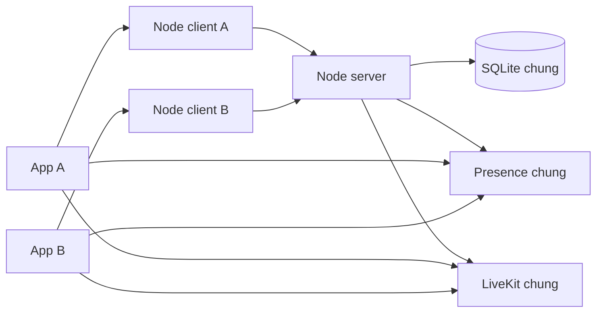
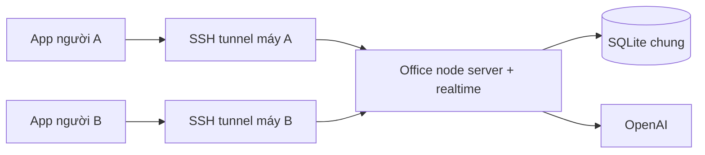

# Hướng dẫn chạy Monastack từ đầu

Client trên máy khác trong LAN: chạy `./tools/start-client.sh` để kết nối server `192.168.224.217`; xem [hướng dẫn client LAN](start-client-lan.vi.md).

Muốn chạy ngay server + node client + app trên máy này với bind `0.0.0.0`: xem [cấu hình local đã thiết lập](local-office.vi.md).

Mặc định mới: node tự setup công ty NVIAI và tạo 11 tài khoản; đăng nhập ngay bằng username như `an` hoặc `triet.le`, password `NviaiSeaxOpenAIHackathon`. Không cần đổi mật khẩu khi login. Xem [danh sách tài khoản và đường dẫn Docker/database](seeded-accounts.md).

Hướng dẫn này mô tả mã nguồn hiện tại, với client macOS. Chạy node server ở phần 2 trước nếu muốn các máy dùng chung tài khoản; chạy riêng phần 1 là đủ cho một máy độc lập.

**Mặc định mới: các member dùng chung office của node server.** App kết nối node local; node local chuyển tiếp request về server. Server quản lý tài khoản, dữ liệu, quyền phòng, presence và cấp token LiveKit. App kết nối trực tiếp tới realtime và LiveKit chung theo thông tin server cấp.



`MONASTACK_WORKSPACE_MODE=shared` là mặc định cho member. Không chạy realtime hoặc LiveKit riêng trên từng client. `MONASTACK_WORKSPACE_MODE=identity` giữ chế độ cũ chỉ chia sẻ tài khoản, dành cho kiểm tra hoặc workspace độc lập có chủ ý.

## 1. Máy người dùng: node + app (client)

### 1.1. Chuẩn bị môi trường

Cần source repository trên máy và các công cụ:

- macOS với Xcode, Command Line Tools và môi trường build macOS đã cấu hình.
- Flutter stable có Dart đáp ứng `app/pubspec.yaml`: Dart `^3.13.5`. Phiên bản đã dùng kiểm tra gần nhất: Flutter `3.47.9`, Dart `3.13.7`.
- Rust stable và Cargo, có trong `PATH` và tại vị trí mặc định `$HOME/.cargo/bin/cargo` mà script đóng gói app sử dụng.
- Python 3 nếu dùng lệnh nhập join code bên dưới.
- Docker Desktop chỉ cần khi bật voice/camera; không cần cho chat văn bản hoặc OpenAI.

Kiểm tra sau khi cài:

```sh
flutter --version
flutter doctor -v
cargo --version
rustc --version
xcodebuild -version
```

Mở terminal tại repository. Trên workspace hiện tại:

```sh
cd /Users/phale/hackathon/monastack-sea-openai-hackathon
```

Trên máy khác, thay đường dẫn bằng thư mục chứa source. Mọi terminal bên dưới đều bắt đầu từ repository root, trừ khi có `cd app`.

### 1.2. Build lần đầu

```sh
cargo build --locked --manifest-path core/Cargo.toml
cargo build --locked --manifest-path backend/office-node/Cargo.toml
cd app
flutter pub get
cd ..
```

App macOS cũng có build phase tự build và đóng gói Rust core. Không cần tự chạy sinh lại Flutter/Rust bridge để sử dụng source hiện có.

### 1.3. Cấu hình node local và OpenAI

Cấu hình nằm tại `runtime/.env` (file `.env` cũ trong workspace này đã được chuyển vào đó). Với checkout mới, tạo thư mục `runtime/` rồi sao chép `.env.example` thành `runtime/.env` nếu chưa có; giữ nguyên file đã có.

Điền bằng editor:

```dotenv
OPENAI_API_KEY=your-key-here
OPENAI_MODEL=gpt-4.1-mini
```

Key được đọc ở backend, không được đóng gói vào app. Node mặc định đọc `runtime/.env` dưới repository root; root `.env` cũ vẫn được hỗ trợ dự phòng. Biến môi trường đã export được ưu tiên hơn `.env`. Sau khi thay key phải khởi động lại node.

Member ở chế độ mặc định `shared` chuyển tiếp agent chat về server, nên chỉ server cần OpenAI key. Node độc lập đóng vai master vẫn cần key riêng.

### 1.4. Chạy node local — terminal A

```sh
umask 077
mkdir -p runtime/db runtime/media runtime/worker runtime/backups
export MONASTACK_DB="$PWD/runtime/db/client-office.sqlite3"
export MONASTACK_NODE_PORT=47830
export MONASTACK_REALTIME_PORT=47831
export MONASTACK_ENV_FILE="$PWD/runtime/.env"
backend/office-node/target/debug/monastack-office-node
```

Giữ terminal chạy. Lần đầu node tạo SQLite, nạp seed, tự setup công ty NVIAI và tạo tài khoản. Nếu muốn join master thay vì tạo công ty độc lập, đặt `MONASTACK_SEED_COMPANY=0` trước lần chạy đầu tiên.

Chọn một trong hai trường hợp:

- **Một máy độc lập:** giữ node chạy, sang bước 1.5 và chọn **Sign in** bằng tài khoản seed. Node local này trở thành master; không cần node server khác.
- **Tham gia server đã có:** chạy lần đầu với `MONASTACK_SEED_COMPANY=0` để local chưa thành master. Dừng node bằng `Ctrl+C`, làm bước 1.6 rồi khởi động lại bằng lệnh trên.

Luôn dùng cùng `MONASTACK_DB` cho lần chạy sau. Đổi đường dẫn sẽ mở một database khác.

### 1.5. Chạy app — terminal B

```sh
cd /Users/phale/hackathon/monastack-sea-openai-hackathon/app
MONASTACK_NODE_PORT=47830 flutter run -d macos
```

Nếu là máy độc lập, chọn **Sign in**, dùng username trong [danh sách seed](seeded-accounts.md) và password `NviaiSeaxOpenAIHackathon`. `an` và `triet.le` có quyền Company Administrator. Chỉ dùng **Set up company** khi đã chủ động tắt seed với `MONASTACK_SEED_COMPANY=0`.

Nếu local đã join server, dùng tài khoản của server để **Sign in**. Người được mời dùng **I have a code**. Admin tạo lời mời tại **Workspace tools → People & invitations**. Phiên đăng nhập được giữ trong macOS Keychain.

Để chat AI: bấm agent trên bản đồ hoặc danh sách **People & agents** → **Chat with agent**. Cũng có thể vào **Workspace tools → Chat with agents**. Lịch sử chat AI được giữ riêng theo agent trong cửa sổ đang mở và mất khi đóng cửa sổ.

### 1.6. Cho node local join master

Điều kiện: master đã có công ty theo phần 2. Trước lần chạy đầu của local, đặt `export MONASTACK_SEED_COMPANY=0`; local chỉ tạo database, chưa tự setup thành master. Giữ biến này trong terminal dùng để join. Nếu local đã thành master, dùng một đường dẫn database mới cho member.

Nếu master ở máy khác, mở terminal C và giữ SSH tunnel:

```sh
ssh -N -o ExitOnForwardFailure=yes \
  -L 47930:127.0.0.1:47830 user@server-host
```

Thay `user@server-host` bằng tài khoản và địa chỉ SSH của server. Cổng local `47930` dẫn tới cổng master `47830` trên server.

Admin đăng nhập master, vào **Workspace tools → Company & nodes**, nhập tên member node và tạo join code. Mỗi mã dùng một lần, hết hạn sau một giờ.

Trong terminal A, khi node local đã dừng và vẫn giữ các biến môi trường ở bước 1.4:

```sh
python3 -c 'import getpass; print(getpass.getpass("Join code: "))' \
  | backend/office-node/target/debug/monastack-office-node join http://127.0.0.1:47930

backend/office-node/target/debug/monastack-office-node
```

Nếu master và member cùng máy, có thể dùng trực tiếp cổng master; mỗi node phải có database và cổng riêng. SSH tunnel phải tiếp tục hoạt động để member chuyển tiếp request office về master. App cũng cần truy cập realtime chung và LiveKit chung; với hai máy vật lý phải cấu hình đường truyền tương ứng.

Sau join, mặc định `shared` dùng chung tài khoản, task, chat, quyền phòng và presence của master. Member không mở realtime riêng. Các record cũ trong SQLite member được giữ lại nhưng không tự merge vào server.

## 2. Node server: master và office dùng chung

### 2.1. Build và chạy master

Server không cần Flutter hoặc GUI để chạy office node. Cần Rust/Cargo và source repository. Các hướng dẫn/test hiện có được xác minh trên macOS; triển khai server Linux chưa được xác minh trong hướng dẫn này.

Tại repository root trên server:

```sh
cargo build --locked --manifest-path backend/office-node/Cargo.toml
umask 077
mkdir -p runtime/db runtime/media runtime/worker runtime/backups
export MONASTACK_DB="$PWD/runtime/db/server-office.sqlite3"
export MONASTACK_NODE_PORT=47830
export MONASTACK_REALTIME_PORT=47831
```

Chuẩn bị `runtime/.env` trên server nếu muốn node server phục vụ chat OpenAI. Không ghi đè file đã có; điền `OPENAI_API_KEY` và `OPENAI_MODEL` như phần 1.3.

```sh
export MONASTACK_ENV_FILE="$PWD/runtime/.env"
backend/office-node/target/debug/monastack-office-node
```

Giữ tiến trình chạy. Mặc định server tự setup NVIAI thành identity master và tạo 11 tài khoản. Không có binary server riêng; không cần nhập setup code.

### 2.2. Đăng nhập công ty trên server

Nếu server ở máy khác, trên máy có app mở tunnel:

```sh
ssh -N -o ExitOnForwardFailure=yes \
  -L 47930:127.0.0.1:47830 \
  -L 47831:127.0.0.1:47831 \
  user@server-host
```

Cổng `47831` trên máy client cần đang trống; dừng node local nếu nó đang chiếm cổng này. Nếu chạy master cùng máy với app, bỏ tunnel và dùng cổng node thực tế.

Chạy app từ thư mục `app` trên máy client:

```sh
MONASTACK_NODE_PORT=47930 flutter run -d macos
```

Chọn **Sign in**, nhập username `triet.le` (hoặc `an`) và password `NviaiSeaxOpenAIHackathon`. Server đã giữ tài khoản master; admin có thể tạo lời mời, join code cho member.

Chỉ khi tắt seed với `MONASTACK_SEED_COMPANY=0`: dùng **Set up company** thủ công. Nếu mất setup code khi chưa cấu hình, mở terminal khác trên server, đặt đúng `MONASTACK_DB` rồi chạy:

```sh
backend/office-node/target/debug/monastack-office-node setup-code
```

Mã mới thay thế mã cũ. Node đã có công ty không cần setup lại.

### 2.3. Chọn cách dùng server sau setup

**Cách A — mỗi người chạy node local + app.**

Làm bước 1.6 trên từng máy. Server là authority chung. Member giữ metadata tham gia master và chuyển tiếp request office về server; không cần OpenAI key hoặc LiveKit riêng. Mọi app dùng chung realtime và LiveKit do server cấp.

**Cách B — nhiều app dùng chung một office node trên server.**

Dùng khi cần mọi người thấy cùng dữ liệu office ngay với code hiện tại:

1. Chạy duy nhất office node server với cổng API `47830`, realtime `47831` như bước 2.1.
2. Mỗi máy client không chạy office node riêng; giữ SSH tunnel ở bước 2.2.
3. Mỗi app chạy `MONASTACK_NODE_PORT=47930 flutter run -d macos` và đăng nhập tài khoản của mình.
4. Các request dùng chung SQLite và realtime server. Agent chat cũng gọi OpenAI từ server; chỉ server cần API key.



App hiện cố định địa chỉ `127.0.0.1`; SSH tunnel giữ nguyên cách kết nối đó. Node chỉ bind loopback, nên không có bước mở trực tiếp cổng API ra LAN/internet. Cách dùng hai máy vật lý qua SSH chưa được xác minh end-to-end; các kiểm tra nhiều node/client hiện có chạy trên một Mac.

### 2.4. Voice/camera và kiểm tra vận hành

Với cấu hình local hai node, `python3 tools/local_office.py start` tự bật một LiveKit dùng chung; không cần chạy thủ công phần dưới. Nút mic/camera hiện ngay sau đăng nhập và tự kết nối media khi bấm, dùng được ngay tại Lobby.

Chat văn bản, task và chat OpenAI không cần LiveKit. Để bật voice/camera trên một máy macOS có Docker Desktop, chạy trước khi khởi động node:

```sh
backend/media/livekit-dev.sh start
export MONASTACK_MEDIA_URL=ws://127.0.0.1:7880
export MONASTACK_MEDIA_KEY_FILE="$PWD/runtime/media/media.key"
```

Sau đó chạy lại node trong cùng terminal để nhận các biến trên. Người dùng bật voice/camera trong app. Hướng dẫn SSH ở trên phục vụ HTTP và presence; **chưa cấu hình đường truyền media giữa các máy**, nên không đủ để xác nhận voice/camera từ xa. Xem [hướng dẫn media hiện có](stage-1-status.md).

Kiểm tra nhanh khi có lỗi:

| Hiện tượng | Kiểm tra |
| --- | --- |
| App chỉ hiện màn hình đăng nhập hoặc không đăng nhập được | Node đang chạy; `MONASTACK_NODE_PORT` của app trùng cổng node hoặc tunnel |
| Hai người đăng nhập được nhưng không thấy chung task/presence | Kiểm tra member dùng `MONASTACK_WORKSPACE_MODE=shared` (mặc định) và trỏ cùng master; realtime ticket phải có cùng URL |
| Chat AI báo chưa cấu hình | `.env` của node nhận request có key; node đã restart; không có biến `OPENAI_API_KEY` rỗng đã export ghi đè |
| Có dữ liệu nhưng không thấy avatar người khác qua tunnel | Cổng realtime server cố định là `47831`, cổng local trống và được forward |
| Join thất bại | Local chưa setup thành master; tunnel hoạt động; mã chưa dùng và chưa hết hạn |
| Cổng đang được dùng | Dừng đúng tiến trình cũ hoặc chọn cổng khác; cập nhật cả app/tunnel tương ứng |
| Flutter báo SDK không tương thích | Dart phải đáp ứng `^3.13.5`; kiểm tra `flutter --version` |

Dừng app/node bằng `Ctrl+C`. Giữ database và `.env` để chạy tiếp; không cần tạo lại công ty hoặc join lại sau mỗi lần restart. Với member node, giữ tunnel tới master để đăng nhập/cập nhật danh tính; với cách B, giữ cả API và realtime tunnel.

Chi tiết kiến trúc: [identity master/member](adr/0008-workspace-identity.md), [realtime](adr/0005-realtime-topology.md), [OpenAI agents](openai-agents.md).

Toàn bộ cấu trúc và cách chuyển dữ liệu cũ: [runtime/README.md](../runtime/README.md).
